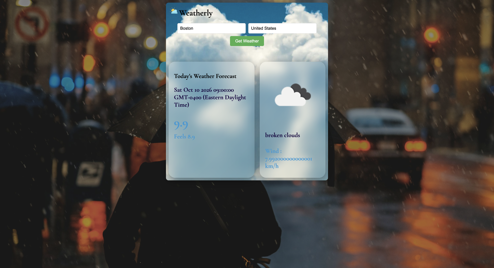

# Weather API App

A lightweight JavaScript project that fetches current weather information for a chosen city and country using the OpenWeatherMap API. The app displays the temperature, perceived temperature, humidity, wind speed, weather description, and an icon representing the current conditions.

## Features

- Search weather by city and country
- Retrieve live forecast data from OpenWeatherMap
- Display temperature in Celsius
- Show feels-like temperature, humidity, wind, and description
- Update the UI with the matching weather icon

## Project Structure

## Tech Stack

- HTML
- CSS
- Vanilla JavaScript
- OpenWeatherMap API

## Usage

1. Enter a city name in the city field.
2. Enter a country name in the country field.
3. Click the weather button.
4. View the current weather data for that location.

## License

This project is intended for educational use and can be adapted for personal or learning purposes.
